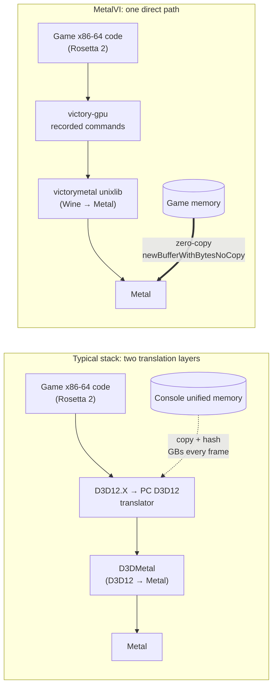
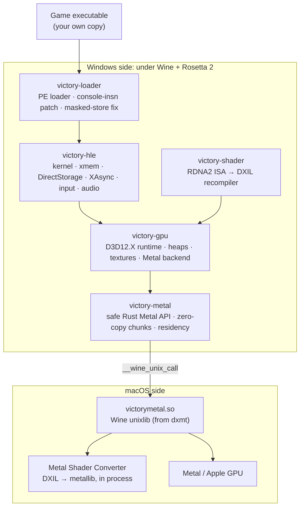
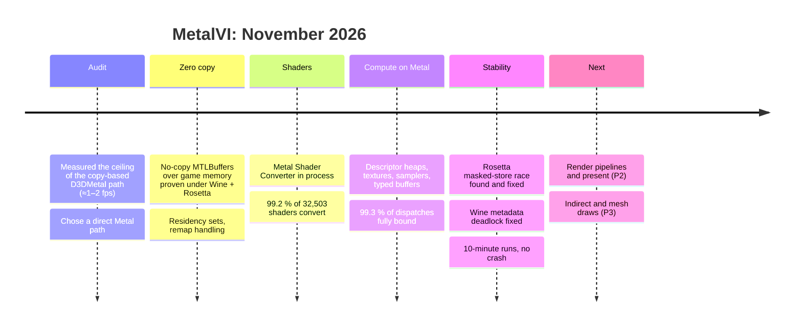

<h1 align="center">MetalVI</h1>

<p align="center">
<b>An open-source research runtime for running the Xbox Series build of Grand Theft Auto VI on Apple Silicon Macs, with a native Metal backend and zero-copy unified memory.</b><br>
<b>Model Used: Antigravity - Gemini 4 Neon, Gemini 4 Hydrogen(Initial Setup)<p>Codex - GPT-6.2 Sol(Development)</p><p>Doubao Work - Deepseek V4.1 Flash(Research & Basic Work since I have no enough tokens)</p> </b><br>
M1 · M2 · M3 · M4 · M5 &nbsp;|&nbsp; macOS 15+ &nbsp;|&nbsp; Rust · Wine · Metal · Metal Shader Converter
</p>

<p align="center">


</p>

<p align="center"><b>English</b> · <a href="README.zh-CN.md">简体中文</a></p>

> **Bring your own game.** MetalVI contains **no game files, assets, keys or proprietary DLLs**, and never will. It runs only from a copy of the game that **you legally own and dumped yourself**. It doesn't download, decrypt or unpack anything, and it contains nothing for getting around DRM. See [Legal](#legal).

---

## The short version

Most attempts to run console games on a Mac stack translation layers: the game's D3D12 calls are translated to PC D3D12, which Apple's D3DMetal translates again into Metal. On a Mac that stack has to pretend the GPU is a discrete card, so the console's **unified memory** gets emulated by copying and hashing gigabytes every frame. We measured about 1.4 GB uploaded and 7.5 GB compared per frame, which caps that design at **about 1–2 fps in 3D, however much you optimise it**.

Apple Silicon *has* unified memory, just like the console. **MetalVI drops the second translation layer.** Its renderer talks to **Metal directly** and hands the game's own memory to the GPU **without copying** (`newBufferWithBytesNoCopy` + `MTLResidencySet`). Shaders go through **Apple's Metal Shader Converter**, linked in-process. The ceiling is set by the GPU, not by memcpy.

**Where it stands (November 2026):** the game boots, runs its menus, loads into the 3D world and starts the opening mission. On the new backend, **99.3% of compute work runs natively on Metal**. Drawing the picture through Metal is the next milestone. **It is not playable yet.** We'd rather say that plainly than overpromise.

## Architecture

### Two ways to get a console game onto a Mac



### Inside MetalVI



## Status at a glance

Measured on an M1 Max (64 GB, macOS 15.7.9), Series S profile.

| Area | State |
| --- | --- |
| Boot, menus, loading screens | ✅ 20–30 fps (D3DMetal path) |
| Into the 3D world, opening mission | ✅ reached |
| Stability | ✅ 10-minute runs with no crash, after the fixes below. It was roughly 1 in 2 runs crashing before |
| Compute shaders on native Metal | ✅ 99.3% of dispatches fully bound (textures, samplers, descriptor heaps, typed buffers) |
| GPU texture detiling, zero copy from game memory | ✅ byte-exact against the CPU reference, on by default |
| CPU-side 3D frame time (rendering off) | 35–75 ms |
| Drawing on Metal (render pipelines, present to window) | 🚧 in progress (P2) |
| Indirect and mesh draws on Metal | ⏳ next (P3) |
| Playable | ❌ not yet |

## What's new in this architecture

### Native Metal backend (`crates/victory-metal`, `crates/victory-gpu/src/backend`, `native/victorymetal`)
- **`victorymetal`**: a Wine unixlib forked from [3Shain/dxmt](https://github.com/3Shain/dxmt)'s `winemetal` (LGPL-2.1), so the Windows-side runtime calls Metal through `__wine_unix_call`. It is loaded on demand, so builds without it still run on D3DMetal.
- **Zero-copy title memory.** Game memory is wrapped in 2 MiB chunks of no-copy `MTLBuffer`s. Remaps are re-wrapped. Everything shaders reach by address is kept in an `MTLResidencySet`.
- **Metal Shader Converter inside the process.** The existing RDNA2 → DXIL recompiler feeds MSC, which converted 99.2% of 32,503 cached shaders offline. Its output is cached on disk. Root signatures are built to match victory's layout, with bounds checks on, because a stray write into zero-copy memory would be real corruption.
- **Descriptor heaps mirrored as `IRDescriptorTableEntry` tables**, filled from victory's view table: buffers, typed buffers, textures and texture views (format and type guarded, since Metal asserts on illegal views), D3D12 and console samplers (deduplicated, because Apple7 aliases past 1024 distinct samplers), and zeroed stand-ins for null descriptors.
- **GPU detiling** of console texture layouts (GFX10 swizzle modes) straight from game memory, with a per-subresource CPU fallback.

### Making Rosetta 2 and Wine behave
- **We found the cause of the random heap corruption.** Under Rosetta 2, every AVX masked store (`vpmaskmovd/q`, `vmaskmovps/pd`) is done as a **read-modify-write of the whole 16/32 bytes**, so the lanes the mask leaves off are written back with stale data. In our test, a `vpmaskmovd` loop silently undid **93% of another thread's writes** to a masked-off lane. The game has 1,130 such stores, and they were corrupting its allocator's free lists. They are now rewritten at load time into per-lane plain stores (`crates/victory-loader/src/masked.rs`, from [VIctory-macOS](https://github.com/pragyaangaur/VIctory-macOS)). Result: zero allocator crashes since.
- **Console-only CPU instructions patched once.** `clzero`, `clwb`, `monitorx`/`mwaitx`, `rdpru`, `rdpid` and SSE4a used to trap about 21,000 times per second in 3D. Each site is now emulated once and then rewritten in place (`console_patch.rs`).
- **No Wine deadlocks from file metadata.** Hot paths read cache files without asking for metadata, because under Rosetta that call could freeze every thread.
- **Fewer memory remaps.** Mapping a page where it is already shown is skipped, because under Wine each remap holds a process-wide lock.
- The game's own hang watchdog can be turned off for slow first runs (`VICTORY_NO_HANG_WATCHDOG=1`).

### The engineering behind it



| | |
| --- | --- |
| 🔬 **Measure before building** | The architecture was chosen from measurements (per-frame upload and hash volume, CPU critical path, thread waits), not guesses. |
| 🧩 **A new backend from the ground up** | Wine unixlib, a safe Rust Metal API, a zero-copy memory manager, MSC integration, descriptor-heap mirroring, texture and sampler translation, GPU detiling, and a pipeline disk cache. |
| 🐞 **Root-causing the hard bugs** | A heap corruption that hit about half of all runs was traced to Rosetta 2 emulating AVX masked stores non-atomically. A dedicated race test proved it, and a load-time patch removed it. A full-process freeze was traced to Wine's mount-manager calls under its global memory lock. |
| ✅ **Verified, not assumed** | Every component ships with tests: byte-exact GPU-vs-CPU detile comparisons, native Metal probes of Apple GPU limits (1024-sampler aliasing, no 64-bit atomics, wave32), unit tests under Wine, and A/B game runs with crash statistics. |
| 🤝 **Built in the open** | Research tasks were split so other developers and AI agents can pick them up and verify them without the game. Fixes from neighbouring projects are credited and kept under compatible licences. |

### By the numbers

| Metric | Value |
| --- | --- |
| Shaders converting through Metal Shader Converter | 32,248 / 32,503 (99.2%) |
| Compute dispatches fully bound on Metal | 99.3% |
| Allocator crashes per run, before → after the masked-store fix | ~45% → 0 |
| Console-instruction traps per second in 3D, before → after | ~21,000 → ~1,100 |
| Masked stores rewritten at load | 1,130 |
| Longest verified run | 10 minutes, no crash |

### Why aim this high
- **Unified memory is the Mac's advantage**, and only a direct Metal path can use it. The copy-based design is capped by bandwidth spent on copying, not by the GPU.
- **Rosetta 2 won't last forever.** Apple supports it fully through macOS 27. Talking to Metal ourselves means the renderer does not depend on D3DMetal, which has no ARM64 build, and leaves a clean path to native ARM64 Wine plus FEX later.
- **Series S is the target profile.** Its GPU budget is within reach of M-series GPUs once translation overhead is gone.

## Roadmap

- [x] P0: `victorymetal` unixlib, zero-copy chunks, residency, safe Rust wrappers
- [x] P1: compute on Metal in-game: MSC in-process, heaps, textures, samplers, typed buffers, GPU detile, disk cache
- [x] Stability: Rosetta masked-store race, Wine metadata deadlock, hang watchdog
- [ ] **P2: drawing on Metal**: VS/PS/mesh pipelines through MSC, render targets, render passes, present to the window *(in progress)*
- [ ] P3: indirect draws, mesh/amplification pipelines, the remaining shader classes (`attributeAtVertex` pixel shaders, the last 64-bit atomic)
- [ ] P4: performance: pipeline pre-warming, batched submissions, MetalFX upscaling
- [ ] Later: native ARM64 Wine + FEX, so it no longer depends on Rosetta

## Building and running on macOS

### Prerequisites
- Apple Silicon Mac, macOS 15 or newer, Rosetta 2 installed.
- A macOS Wine with `macdrv_functions` (a GameHub/gamesir-labs Wine-Proton build works), plus Apple's Game Porting Toolkit for the D3DMetal path.
- **Apple's Metal Shader Converter**, installed from Apple's developer site (it provides `/usr/local/lib/libmetalirconverter.dylib`). MetalVI does not redistribute it: `native/victorymetal/build.sh` links against your own installed copy.
- Your own dump of the game.

```bash
brew install zig llvm@21 lld@21
rustup target add x86_64-pc-windows-gnullvm
cargo install cargo-zigbuild
```

### Build
```bash
export PATH="/opt/homebrew/opt/llvm@21/bin:/opt/homebrew/opt/lld@21/bin:$PATH"
cargo zigbuild --release -p victory --target x86_64-pc-windows-gnullvm --locked
# The Metal unixlib, installed into your Wine (WINE_ROOT=/path/to/wine):
native/victorymetal/build.sh --install
```

### Configure (outside the repository)
Create a runtime folder outside this clone, for example `~/metalvi-runtime`, with a `victory.toml`:
```toml
[paths]
game_dir = 'Z:\Users\<you>\path\to\your\game_dump'
cache_dir = 'Z:\Users\<you>\metalvi-runtime\cache'
data_dir = 'Z:\Users\<you>\metalvi-runtime\data'
test_titles = []
```

### Pre-warm shaders, then launch
```bash
cd ~/metalvi-runtime
/path/to/MetalVI/scripts/run-mac.sh /path/to/MetalVI/target/x86_64-pc-windows-gnullvm/release/victory.exe \
  warm --jobs 6 2>&1 | tee warm.log
VICTORY_METAL=compute VICTORY_NO_HANG_WATCHDOG=1 \
/path/to/MetalVI/scripts/run-mac.sh /path/to/MetalVI/target/x86_64-pc-windows-gnullvm/release/victory.exe \
  run --execute --console series-s 'Z:\Users\<you>\path\to\your\game_dump\title.exe' 2>&1 | tee run.log
```
Always pipe through `2>&1 | tee`: under Wine, redirecting with `>` drops the console output.

### Useful switches
| Variable | Effect |
| --- | --- |
| `VICTORY_METAL=compute` | Run compute work on the native Metal backend |
| `VICTORY_METAL_GPU_DETILE=0` | Detile textures on the CPU instead of the GPU |
| `VICTORY_METAL_TEXTURES=0` | Leave texture slots empty (for bisecting) |
| `VICTORY_METAL_CACHE=<dir>` | Where converted Metal pipelines are cached |
| `VICTORY_PATCH_MASKED=none` | Keep the masked stores as they are (not recommended under Rosetta) |
| `VICTORY_NO_HANG_WATCHDOG=1` | Turn off the game's hang watchdog |
| `VICTORY_INSN_PATCH=0` | Trap-and-emulate console instructions every time |

### Keyboard controls
| Input | Action |
| :--- | :--- |
| `Enter` / `Space` | Confirm (A) |
| `Backspace` | Back (B) |
| `W` `A` `S` `D` | Left stick |
| `I` `J` `K` `L` | Right stick (camera) |
| Arrow keys | D-pad |
| `Q` / `E` | LB / RB |
| `Left Shift` / `Right Shift` | LT / RT |
| `Esc` | Menu |

## FAQ

**Can I play GTA VI on my Mac with this today?**
Not yet. It boots, loads the world and starts the story, but drawing through the new Metal backend is still being built, and the old D3DMetal path is far too slow to play (about 0.1–2 fps in 3D).

**Which Macs will it target?**
Any Apple Silicon Mac (M1 or newer). More GPU cores and more memory will matter. Development and measurements are done on an M1 Max.

**Is this an emulator?**
No CPU emulator of our own. The game's x86-64 code runs through Rosetta 2, and Wine provides Windows. MetalVI implements the console's system libraries (high-level emulation), recompiles the console GPU's RDNA2 shaders, and renders through Metal.

**Does it work with CrossOver / Whisky / GPTK?**
The D3DMetal path runs on a GPTK-capable Wine. The native Metal backend needs our `victorymetal` unixlib installed into the Wine you use.

**How is this different from other ports?**
Most efforts run the game through D3D12 → D3DMetal and fight the cost of emulating unified memory. MetalVI's renderer goes straight to Metal with zero-copy memory. That is more work up front, but it has a much higher ceiling on Apple Silicon.

**Where do I get the game files?**
From a copy you own, dumped by you. We can't help with obtaining game files, and issues or PRs that share or link them will be closed.

## Contributing

Contributions from people **and AI coding agents** are welcome. The work is split into small, objectively checkable tasks (pure functions with tests, byte-exact GPU-vs-CPU comparisons, native Metal probes), so a contribution can be verified without the game.
- Good first areas: Metal state mapping, Metal probes for Apple GPU limits, shader lowering for Metal Shader Converter, test tooling.
- Never commit anything from the game. `cargo xtask policy` and the pre-commit hook enforce this (see `docs/asset-policy.md`).
- Please include how you verified a change (commands and output) in your PR.

## Legal

- MetalVI is an independent research and interoperability project. It is **not affiliated with, endorsed or sponsored by** Rockstar Games, Take-Two Interactive, Microsoft or Apple. *Grand Theft Auto*, *Xbox* and *Metal* are trademarks of their respective owners, used here only to describe compatibility.
- The repository holds only original source code under open-source licences. There are no game binaries, assets, keys, SDK headers or proprietary DLLs. Apple's Metal Shader Converter and Game Porting Toolkit are obtained by each user from Apple under Apple's terms, and are not included.
- Use it only with software you legally own. We do not support piracy or DRM circumvention.

## Credits and licences

MetalVI is licensed **GPL-3.0-or-later** (see [LICENSE](LICENSE)). `native/victorymetal` is **LGPL-2.1-or-later** (from dxmt and Wine, see `native/victorymetal/NOTICE.md`).

Built on the work of:
- **[Marvisak/VIctory](https://github.com/Marvisak/VIctory)**: the original loader, HLE runtime, D3D12 translator and RDNA2 shader recompiler.
- **[3Shain/dxmt](https://github.com/3Shain/dxmt)**: the `winemetal` layer that `victorymetal` is forked from.
- **[pragyaangaur/VIctory-macOS](https://github.com/pragyaangaur/VIctory-macOS)**: the masked-store patch, the hang-watchdog patch, and the Wine metadata and remap fixes (GPL-3.0).
- **[fxceless/victory-fork](https://github.com/fxceless/victory-fork)**, **[JoshuuDev/victory-amd](https://github.com/JoshuuDev/victory-amd)**, **[Zettrox/ztrx](https://github.com/Zettrox/ztrx)**: shader, descriptor, texture, DirectStorage and pipeline work.
- Design references (ideas only): xcl, TomBox, five-star-recomp, KosmicKrisp, MoltenVK, Mullion.

---

### 中文

完整中文说明见 **[README.zh-CN.md](README.zh-CN.md)**。

<sub>Keywords: GTA 6 Mac, GTA VI macOS, Grand Theft Auto VI Apple Silicon, M1 M2 M3 M4 M5, Metal backend, Metal Shader Converter, Xbox Series X|S compatibility layer, RDNA2 shader recompiler, Rosetta 2, Wine, Game Porting Toolkit, D3DMetal, zero-copy unified memory, open source.</sub>
