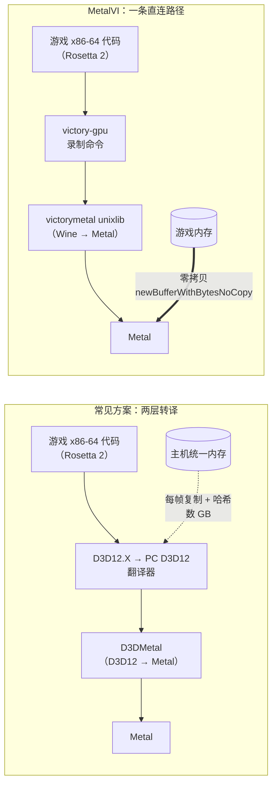
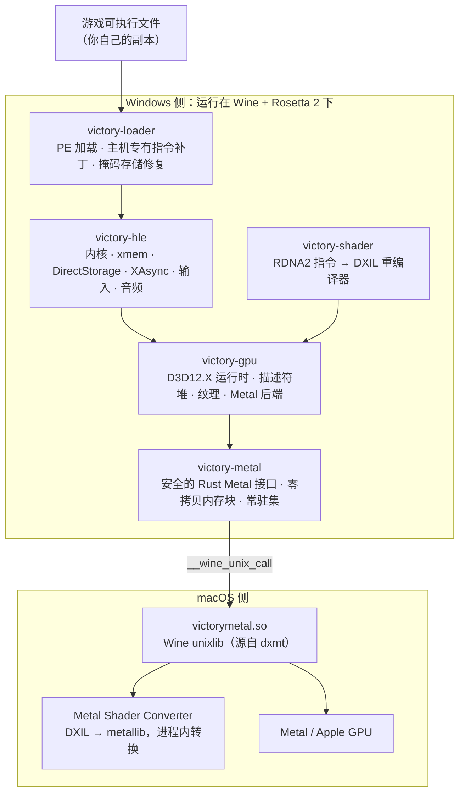
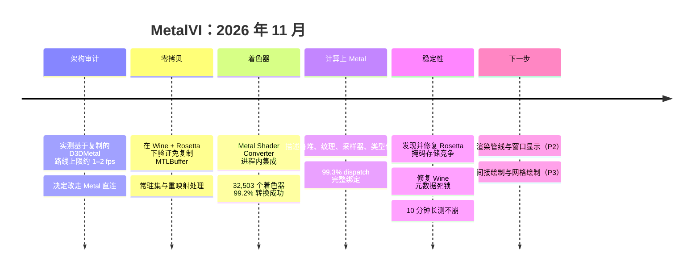

<h1 align="center">MetalVI</h1>

<p align="center">
<b>让 GTA VI（Xbox Series 版）在 Apple Silicon Mac 上运行的开源研究项目：原生 Metal 后端，统一内存零拷贝。</b><br>
M1 · M2 · M3 · M4 · M5 &nbsp;|&nbsp; macOS 15+ &nbsp;|&nbsp; Rust · Wine · Metal · Metal Shader Converter
</p>

<p align="center">


</p>

<p align="center"><a href="README.md">English</a> · <b>简体中文</b></p>

> **请自备正版游戏。** 本仓库**不包含任何游戏文件、资源、密钥或专有 DLL**，以后也不会包含。它只能使用**你自己合法拥有、自行导出**的游戏副本运行，不提供下载、解密或解包，也不包含任何绕过 DRM 的内容。详见[法律声明](#法律声明)。

---

## 一句话说明

常见的做法是层层转译：游戏的 D3D12 调用先被翻译成 PC 的 D3D12，再由苹果的 D3DMetal 翻译成 Metal。在 Mac 上，这条路必须把 GPU 当成独立显卡，于是主机的**统一内存**只能靠每帧复制、哈希几个 GB 来模拟。我们实测：每帧上传约 1.4 GB、比对约 7.5 GB。所以无论怎么优化，**3D 场景大约只能到 1–2 fps**。

而 Apple Silicon 本身就是统一内存，和主机一样。**MetalVI 去掉了第二层转译**：渲染器**直接调用 Metal**，把游戏自己的内存**零拷贝**交给 GPU（`newBufferWithBytesNoCopy` + `MTLResidencySet`）；着色器通过**苹果官方的 Metal Shader Converter** 在进程内转换。性能上限由 GPU 决定，而不是被内存复制卡住。

**当前进展（2026 年 11 月）：** 游戏能启动、进入菜单、加载进 3D 世界并开始开场任务；新后端上 **99.3% 的计算工作已经在原生 Metal 上运行**。下一个里程碑是通过 Metal 把画面画出来。**目前还不能玩**，这一点我们如实说明。

## 架构

### 两种把主机游戏搬到 Mac 的方式



### MetalVI 内部结构



## 状态一览

测试机：M1 Max（64 GB，macOS 15.7.9），Series S 配置。

| 方面 | 状态 |
| --- | --- |
| 启动、菜单、加载画面 | ✅ 20–30 fps（D3DMetal 路径） |
| 进入 3D 世界、开场任务 | ✅ 已到达 |
| 稳定性 | ✅ 修复后 10 分钟长测不崩溃（之前大约每 2 轮崩 1 轮） |
| 计算着色器跑在原生 Metal 上 | ✅ 99.3% 的 dispatch 完整绑定（纹理、采样器、描述符堆、类型化缓冲） |
| GPU 解 tile（直接从游戏内存零拷贝读取） | ✅ 与 CPU 结果逐字节一致，默认开启 |
| CPU 侧 3D 帧时间（关闭渲染时） | 35–75 ms |
| 通过 Metal 绘制（渲染管线、显示到窗口） | 🚧 开发中（P2） |
| Metal 上的间接绘制和网格绘制 | ⏳ 下一步（P3） |
| 可以玩 | ❌ 暂不可玩 |

## 新架构的亮点

### 原生 Metal 后端
- **victorymetal**：基于 [3Shain/dxmt](https://github.com/3Shain/dxmt) 的 `winemetal`（LGPL-2.1）派生的 Wine unixlib，让 Windows 侧通过 `__wine_unix_call` 直接调用 Metal。它是按需加载的，没装的话程序照样走 D3DMetal 运行。
- **游戏内存零拷贝**：游戏内存按 2 MiB 一块包装成免复制的 `MTLBuffer`，页重映射时重新包装；所有被着色器按地址访问的资源都放进 `MTLResidencySet` 保持常驻。
- **Metal Shader Converter 进程内转换**：现有的 RDNA2 → DXIL 重编译器直接接 MSC，离线测试中 32,503 个着色器有 99.2% 转换成功，转换结果缓存在磁盘上。根签名按 victory 的布局生成，并开启越界检查，因为在零拷贝内存上一次越界写就是真实的内存损坏。
- **描述符堆镜像**成 `IRDescriptorTableEntry` 表：涵盖缓冲、类型化缓冲、纹理和纹理视图（会校验格式和类型，因为非法视图会让 Metal 直接断言）、D3D12 和主机采样器（会去重，因为 Apple7 超过 1024 个不同采样器后会串用）、空描述符（用清零的 1×1 纹理替代）。
- **GPU 解 tile**：直接从游戏内存把主机的纹理布局（GFX10 swizzle 模式）解开，GPU 处理不了的子资源回退到 CPU。

### 驯服 Rosetta 2 和 Wine
- **找到了随机堆损坏的真正原因。** Rosetta 2 把所有 AVX 掩码存储（`vpmaskmovd/q`、`vmaskmovps/pd`）实现成**对整块 16/32 字节的读-改-写**，掩码本该跳过的通道会被写回旧值。我们的竞争测试里，一个 `vpmaskmovd` 循环悄悄抹掉了另一个线程 **93% 的写入**。游戏里有 1,130 条这类指令，它们一直在破坏游戏分配器的空闲链表。现在这些指令在加载时被改写成逐通道的普通存储（`crates/victory-loader/src/masked.rs`，来自 [VIctory-macOS](https://github.com/pragyaangaur/VIctory-macOS)），之后分配器崩溃一次都没再出现。
- **主机专有 CPU 指令只修补一次**：`clzero`、`clwb`、`monitorx`/`mwaitx`、`rdpru`、`rdpid`、SSE4a 以前在 3D 中每秒触发约 21,000 次异常，现在每处只模拟一次，然后原地改写（`console_patch.rs`）。
- **消除 Wine 文件元数据死锁**：热点路径读缓存文件时不再查询文件元数据，因为在 Rosetta 下这个调用可能让所有线程卡死。
- **减少内存重映射**：目标位置已经显示同一个物理页时直接跳过，因为在 Wine 下每次重映射都要占用一把进程级的全局锁。
- 首次运行较慢时，可以关闭游戏自带的卡死看门狗（`VICTORY_NO_HANG_WATCHDOG=1`）。

### 背后的工程投入



| | |
| --- | --- |
| 🔬 **先测量再动手** | 架构选择基于实测数据（每帧上传和哈希量、CPU 关键路径、线程等待），而不是凭猜测。 |
| 🧩 **从零搭建新后端** | Wine unixlib、安全的 Rust Metal 接口、零拷贝内存管理、MSC 集成、描述符堆镜像、纹理与采样器翻译、GPU 解 tile、管线磁盘缓存。 |
| 🐞 **攻克疑难问题** | 大约一半的运行都会出现的堆损坏，最终定位到 Rosetta 2 对 AVX 掩码存储的非原子模拟：用专门的竞争测试证实，再用加载期补丁根除。整个进程卡死的问题，定位到 Wine 在持有全局内存锁时调用挂载管理器。 |
| ✅ **验证而非假设** | 每个组件都配有测试：GPU 与 CPU 解 tile 逐字节对比、Apple GPU 硬件限制的原生 Metal 探针（1024 采样器串用、无 64 位原子、wave32）、Wine 下的单元测试，以及带崩溃统计的 A/B 实机对照。 |
| 🤝 **开放协作** | 研究任务拆成了无需游戏文件也能验收的小任务，开发者和 AI 智能体都可以参与。借鉴的周边项目修复都注明出处，并保持许可证兼容。 |

### 关键数字

| 指标 | 数值 |
| --- | --- |
| 通过 Metal Shader Converter 转换成功的着色器 | 32,248 / 32,503（99.2%） |
| Metal 上完整绑定的计算 dispatch | 99.3% |
| 每轮运行出现分配器崩溃的比例：修复前 → 修复后 | 约 45% → 0 |
| 3D 中主机专有指令每秒触发的异常：修复前 → 修复后 | 约 21,000 → 约 1,100 |
| 加载时改写的掩码存储指令 | 1,130 条 |
| 已验证的最长连续运行 | 10 分钟，零崩溃 |

### 为什么追求更高的上限
- **统一内存是 Mac 的天然优势**，只有直连 Metal 才能真正用上。基于复制的方案，瓶颈在于花在复制上的带宽，而不是 GPU。
- **Rosetta 2 不会永远存在**：苹果只承诺完整支持到 macOS 27。自己直接调用 Metal，渲染器就不依赖没有 ARM64 版本的 D3DMetal，将来也能顺利迁移到原生 ARM64 Wine + FEX。
- **以 Series S 为目标画质**：去掉转译开销之后，它的 GPU 负载在 M 系列芯片的能力范围内。

## 路线图

- [x] P0：victorymetal unixlib、零拷贝内存块、常驻集、安全的 Rust 封装
- [x] P1：游戏内计算跑在 Metal 上：MSC 进程内转换、描述符堆、纹理、采样器、类型化缓冲、GPU 解 tile、磁盘缓存
- [x] 稳定性：Rosetta 掩码存储竞争、Wine 元数据死锁、卡死看门狗
- [ ] **P2：通过 Metal 绘制**：VS/PS/网格管线走 MSC、渲染目标、渲染通道、显示到窗口 *（进行中）*
- [ ] P3：间接绘制、网格/放大管线、剩余几类着色器（`attributeAtVertex` 像素着色器、最后一个 64 位原子）
- [ ] P4：性能：管线预热、批量提交、MetalFX 超分
- [ ] 远期：原生 ARM64 Wine + FEX，摆脱对 Rosetta 的依赖

## 在 macOS 上编译和运行

### 准备
- Apple Silicon Mac，macOS 15 或更新版本，已安装 Rosetta 2。
- 带 `macdrv_functions` 的 macOS Wine（GameHub/gamesir-labs 的 Wine-Proton 可用）；走 D3DMetal 路径还需要苹果的 Game Porting Toolkit。
- **苹果的 Metal Shader Converter**：从苹果开发者网站自行安装（会提供 `/usr/local/lib/libmetalirconverter.dylib`）。本项目不分发它，`native/victorymetal/build.sh` 链接的是你本机安装的副本。
- 你自己导出的游戏副本。

```bash
brew install zig llvm@21 lld@21
rustup target add x86_64-pc-windows-gnullvm
cargo install cargo-zigbuild
```

### 编译
```bash
export PATH="/opt/homebrew/opt/llvm@21/bin:/opt/homebrew/opt/lld@21/bin:$PATH"
cargo zigbuild --release -p victory --target x86_64-pc-windows-gnullvm --locked
# 编译 Metal unixlib 并安装到你的 Wine（WINE_ROOT=/path/to/wine）：
native/victorymetal/build.sh --install
```

### 配置（放在仓库外面）
在仓库外新建一个运行目录，比如 `~/metalvi-runtime`，里面放一个 `victory.toml`：
```toml
[paths]
game_dir = 'Z:\Users\<you>\path\to\your\game_dump'
cache_dir = 'Z:\Users\<you>\metalvi-runtime\cache'
data_dir = 'Z:\Users\<you>\metalvi-runtime\data'
test_titles = []
```

### 预热着色器，然后启动
```bash
cd ~/metalvi-runtime
/path/to/MetalVI/scripts/run-mac.sh /path/to/MetalVI/target/x86_64-pc-windows-gnullvm/release/victory.exe \
  warm --jobs 6 2>&1 | tee warm.log
VICTORY_METAL=compute VICTORY_NO_HANG_WATCHDOG=1 \
/path/to/MetalVI/scripts/run-mac.sh /path/to/MetalVI/target/x86_64-pc-windows-gnullvm/release/victory.exe \
  run --execute --console series-s 'Z:\Users\<you>\path\to\your\game_dump\title.exe' 2>&1 | tee run.log
```
请始终用 `2>&1 | tee` 记录日志：在 Wine 下直接用 `>` 重定向会丢失控制台输出。

### 常用开关
| 变量 | 作用 |
| --- | --- |
| `VICTORY_METAL=compute` | 计算工作走原生 Metal 后端 |
| `VICTORY_METAL_GPU_DETILE=0` | 纹理改用 CPU 解 tile |
| `VICTORY_METAL_TEXTURES=0` | 纹理槽位留空（用于二分排查） |
| `VICTORY_METAL_CACHE=<dir>` | 转换好的 Metal 管线缓存位置 |
| `VICTORY_PATCH_MASKED=none` | 不改写掩码存储（Rosetta 下不建议） |
| `VICTORY_NO_HANG_WATCHDOG=1` | 关闭游戏自带的卡死看门狗 |
| `VICTORY_INSN_PATCH=0` | 主机专有指令改回每次都陷入模拟 |

### 键盘操作
| 按键 | 作用 |
| :--- | :--- |
| `Enter` / `Space` | 确认（A） |
| `Backspace` | 返回（B） |
| `W` `A` `S` `D` | 左摇杆 |
| `I` `J` `K` `L` | 右摇杆（视角） |
| 方向键 | 十字键 |
| `Q` / `E` | LB / RB |
| `左 Shift` / `右 Shift` | LT / RT |
| `Esc` | 菜单 |

## 常见问题

**现在能在 Mac 上玩 GTA VI 吗？**
还不能。游戏能启动、加载世界、开始剧情，但新 Metal 后端的绘制部分还在开发中；旧的 D3DMetal 路径太慢，没法玩（3D 大约 0.1–2 fps）。

**会支持哪些 Mac？**
所有 Apple Silicon Mac（M1 及更新）。GPU 核心越多、内存越大越好。开发和测试在 M1 Max 上进行。

**这是模拟器吗？**
我们没有自己写 CPU 模拟器。游戏的 x86-64 代码由 Rosetta 2 运行，Wine 提供 Windows 环境。MetalVI 实现了主机的系统库（高层模拟），重编译主机 GPU 的 RDNA2 着色器，并通过 Metal 渲染。

**能和 CrossOver / Whisky / GPTK 一起用吗？**
D3DMetal 路径可以在支持 GPTK 的 Wine 上运行；原生 Metal 后端需要把我们的 victorymetal unixlib 安装到你使用的 Wine 里。

**和其他移植项目有什么不同？**
多数项目走 D3D12 → D3DMetal，和模拟统一内存的开销苦苦缠斗。MetalVI 的渲染器直连 Metal、内存零拷贝：前期工作量更大，但在 Apple Silicon 上的上限高得多。

**游戏文件从哪里来？**
来自你自己拥有、自行导出的副本。我们不提供任何获取游戏文件的帮助，分享或链接游戏文件的 issue/PR 会被直接关闭。

## 参与贡献

欢迎开发者和 **AI 编程智能体**参与。工作被拆成了可以客观验收的小任务：带测试的纯函数、GPU 与 CPU 逐字节对比、原生 Metal 探针等，不需要游戏文件就能完成和验证。
- 适合上手的方向：Metal 状态映射、Apple GPU 限制的 Metal 探针、面向 Metal Shader Converter 的着色器降级写法、测试工具。
- 绝对不要提交任何游戏内容。`cargo xtask policy` 和 pre-commit 钩子会强制检查（见 `docs/asset-policy.md`）。
- 提交 PR 时请写明你是如何验证的（命令和输出）。

## 法律声明

- MetalVI 是独立的研究与互操作项目，**与** Rockstar Games、Take-Two Interactive、微软、苹果**均无关联，也未获得其认可或赞助**。*Grand Theft Auto*、*Xbox*、*Metal* 均为各自所有者的商标，这里仅用于说明兼容性。
- 仓库只包含开源许可下的原创源代码，不含游戏二进制、资源、密钥、SDK 头文件或专有 DLL。苹果的 Metal Shader Converter 和 Game Porting Toolkit 由每位用户按苹果的条款自行获取，本仓库不包含。
- 请只配合你合法拥有的软件使用。我们不支持盗版，也不支持绕过 DRM。

## 鸣谢与许可

MetalVI 采用 **GPL-3.0-or-later** 许可（见 [LICENSE](LICENSE)）。`native/victorymetal` 采用 **LGPL-2.1-or-later**（来自 dxmt 和 Wine，见 `native/victorymetal/NOTICE.md`）。

本项目建立在以下工作之上：
- **[Marvisak/VIctory](https://github.com/Marvisak/VIctory)**：原始的加载器、HLE 运行时、D3D12 翻译器和 RDNA2 着色器重编译器。
- **[3Shain/dxmt](https://github.com/3Shain/dxmt)**：victorymetal 派生自它的 `winemetal` 层。
- **[pragyaangaur/VIctory-macOS](https://github.com/pragyaangaur/VIctory-macOS)**：掩码存储补丁、卡死看门狗补丁，以及 Wine 元数据和重映射修复（GPL-3.0）。
- **[fxceless/victory-fork](https://github.com/fxceless/victory-fork)**、**[JoshuuDev/victory-amd](https://github.com/JoshuuDev/victory-amd)**、**[Zettrox/ztrx](https://github.com/Zettrox/ztrx)**：着色器、描述符、纹理、DirectStorage 和管线方面的工作。
- 设计参考（仅借鉴思路）：xcl、TomBox、five-star-recomp、KosmicKrisp、MoltenVK、Mullion。

<sub>关键词：GTA 6 Mac、GTA VI macOS、GTA6 苹果电脑、Apple Silicon、M1 M2 M3 M4 M5、Metal 后端、Metal Shader Converter、Xbox Series 兼容层、RDNA2 着色器重编译、Rosetta 2、Wine、Game Porting Toolkit、D3DMetal、统一内存零拷贝、开源</sub>
